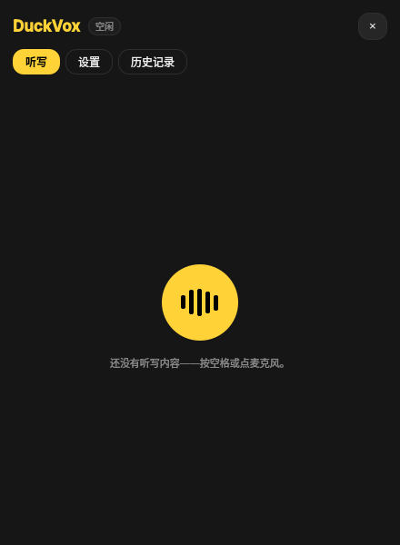
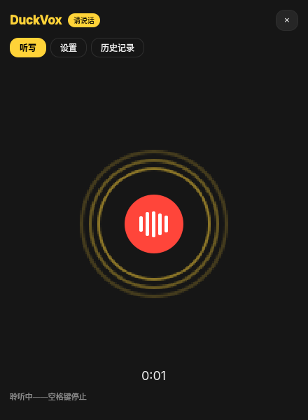
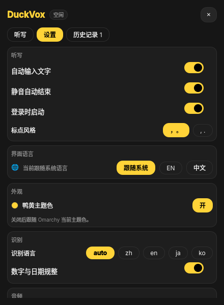

<div align="center">

# duckvox

**Offline voice input for Omarchy — press a key, speak, and your words land in the focused window.**

No cloud, no accounts, no clipboard manager. SenseVoice runs on your CPU.

[Quick start](#quick-start) · [How it works](#how-it-works) · [Global hotkeys](#global-hotkeys) · [Bar panel](#omarchy-bar-panel) · [Build](#building-from-source)

</div>

<p align="center">
  
  
  
</p>

<p align="center">
  <sub><b>idle</b> · <b>listening</b> · <b>settings</b> — real frames from the app, real recognition, real theme colors.</sub>
</p>

---

## What it is

duckvox is a native Omarchy desktop app (C++ / Qt Quick) that turns speech into text
in whatever window has focus. It began as a rebuild of
[crostivoice](https://github.com/david-heinemeier-hansson/crostivoice) — a
ChromeOS extension for the same job — reimagined as a Wayland/Hyprland citizen
with Omarchy's theming, launcher integration and dictation plumbing.

What it gets you:

- **Fully offline dictation.** Recognition is SenseVoice (zh / en / ja / ko / yue)
  via [sherpa-onnx](https://github.com/k2-fsa/sherpa-onnx), running locally.
  Nothing leaves the machine.
- **Global push-to-talk.** Hold `Alt_R` to talk, release to insert. `Alt+Space`
  toggles tap-to-dictate. Wired through Omarchy's own dictation backend system,
  so the keybindings are the system's, not duckvox's.
- **Types into the focused window.** `wtype` on Wayland, with `wl-copy` as the
  fallback so the text is never lost.
- **Follows your theme.** Accent color and corner radius come from the live
  Omarchy theme (`omarchy-theme` and Hyprland's effective rounding). Change the
  theme and duckvox changes with it — no restart.
- **Duck yellow, or your theme.** The signature `#FFD338` can take over the
  chrome as a brand mode (on by default). Switch it off in Settings ▸ Appearance
  and every accent falls back to the live Omarchy theme color — verified against
  a blue test theme, not assumed.
- **Speaks your language.** The UI follows Omarchy's chosen language; English
  and Chinese catalogs ship in the box.
- **Bar panel.** A microphone icon in the Omarchy bar shows idle / listening /
  transcribing at a glance and opens a panel with the last transcript.

## Quick start

```sh
bin/install          # builds an Arch package and installs it
omarchy dictation use duckvox   # make duckvox the dictation backend (Alt_R / Alt+Space)
duckvox                  # open the window; press M once to fetch the model
```

Omarchy's built-in `omarchy install dictation` targets Superwhisper and Voxtype;
duckvox plugs into the same backend system, so `omarchy dictation use duckvox` is all it
takes to become the active backend — and `omarchy dictation start|stop|toggle`
then drives it.

The model is a one-time ~163 MB download on first run (~230 MB on disk after
extraction), stored under `~/.local/share/duckvox/models`. **No model, no problem:**
the app opens, tells you the model is missing, and dictation starts working the
moment you install it — the rest of the app (history, settings, dictionary)
works from the first launch.

## How it works

```
     Alt_R held                    audio                    text
  keybind ──▶ omarchy-dictation ──▶ duckvox ──▶ parec ──▶ VAD ──▶ wav
                                         └──▶ sherpa-onnx (SenseVoice)
                                              └──▶ TextPipeline ──▶ wtype
```

The pieces, and why each is shaped the way it is:

| Module | Responsibility |
| --- | --- |
| `src/recorder.cpp` | Captures raw 16 kHz mono from `parec`, computes RMS over 20 ms windows, and ends a take on trailing silence, at max length, or on release. |
| `src/engine.cpp` | Owns the SenseVoice model and the `sherpa-onnx-offline` process; parses its JSON result, keeps download progress byte-accurate. |
| `src/textpipeline.cpp` | Applies the hot-word dictionary longest-first, then punctuation style (full-width `，。` or half-width `, .`). |
| `src/inserter.cpp` | Types the text with `wtype -s 1000` (slow enough for apps to keep up), falls back to `wl-copy`. |
| `src/backend.cpp` | The state machine the UI binds to: idle → listening → processing → done, plus history and errors. |
| `src/controlserver.cpp` | A small newline-JSON socket, so `duckvox --hold-start` reaches the already-running daemon. |
| `src/theme.cpp` | Reads the Omarchy theme directory and Hyprland rounding, re-reading on change. Brand yellow is exposed separately as `brand`, so `duckYellow` never overrides the theme accent. |

Two design decisions worth calling out:

- **Push-to-talk ignores the silence gap.** Tap-to-dictate ends a take after a
  pause; a *held* take must not, or a long sentence gets cut in half. So
  `holdStart()` captures with auto-stop disabled and ends on release instead.
- **The daemon owns the microphone.** A keypress must not pay for process
  startup or model load, so `duckvox --minimized` runs a socket-owning daemon and the
  CLI is a thin client that knocks on it.

## Global hotkeys

Installed, duckvox registers itself as an Omarchy dictation backend, which gives you
the system bindings:

| Key | Action |
| --- | --- |
| `Alt_R` (hold) | Push-to-talk — speak while held, insert on release |
| `Alt+Space` | Toggle tap-to-dictate |

These come from `/usr/share/omarchy/default/hypr/bindings/dictation.lua`, so they
work in any application, and they are remappable the same way the rest of
Omarchy's keys are.

## Omarchy bar panel

The panel lives at `~/.config/omarchy/plugins/duckvox-panel/` and is registered in
`~/.config/omarchy/shell.json`. The bar icon is drawn as a vector microphone and
recolors with the theme: dim when idle, urgent while listening, pulsing while
transcribing. Clicking it opens a panel with the status line, the most recent
transcript, and quick actions.

## Keys

In the duckvox window:

| Key | Action |
| --- | --- |
| `Space` | Start / stop dictation |
| `R` | Insert the last transcript into the focused window |
| `C` | Copy the last transcript |
| `M` | Download / retry the speech model |

## Settings

Everything is set from the window — no config files to hand-edit:

| Setting | Values | Effect |
| --- | --- | --- |
| Insert text automatically | on / off | Type into the focused window, or only copy to clipboard |
| Auto-stop on silence | on / off | End a tap-to-dictate take after a pause |
| Punctuation | `，。` / `, .` | Full-width or half-width marks |
| Language | auto / zh / en / ja / ko | Recognition language (SenseVoice's five) |
| Number & date normalization | on / off | ITN — "早上九点" → "9 点" |
| Microphone | any PulseAudio source | Recorded by name; follows the system default when unset |
| Resume after silence | 0.4 – 3.0 s | How much silence ends a take |
| Hot-word dictionary | editable list | Longest-first text replacement after recognition |

Settings persist as JSON at `~/.local/share/duckvox/settings.json` and apply to
the running daemon immediately.

## Command line

The daemon speaks a small newline-JSON protocol; the CLI is the convenient face
of it, and is what the Omarchy adapter drives.

| Command | Effect |
| --- | --- |
| `duckvox --status` | Print the daemon's state and exit non-zero if it is not running |
| `duckvox --toggle` | Start / stop tap-to-dictate |
| `duckvox --hold-start` / `--hold-stop` | Push-to-talk begin / end |
| `duckvox --copy-last` | Copy the last transcript's **new part** (what it appended to the previous take) |
| `duckvox --show` / `--minimized` | Show the window / run windowless as the daemon |

## Building from source

```sh
bin/build     # debug build, binary at build/duckvox
bin/test      # 12 unit tests
bin/install   # Arch package + install, so it appears in the launcher
```

Dependencies: `qt6-base` `qt6-declarative` `qt6-wayland` `libpulse` (for
`parec`) `wtype` `wl-clipboard` `curl`. The package also installs
`sherpa-onnx-offline` (a 35 MB static build); the model is fetched separately on
first run.

Recognition notes, for anyone comparing against other SenseVoice builds:

- The model is the **int8-only** export. The full-precision tarball is 1 GB
  because it also carries a 895 MB fp32 model duckvox never loads.
- The 2.x CLI renamed its flags to `--sense-voice-use-itn` and
  `--sense-voice-language`; duckvox uses those, and its output is now one JSON
  object per file rather than a `Recognized text:` line.
- The model tarball contains **no** binary, which is why the package ships
  `sherpa-onnx-offline` separately instead of downloading it at first run.

### Regenerating the screenshots

`tools/screenshot_window.cpp` renders the real window offscreen and grabs a
frame in each state. Speech is real: a PATH shim makes the recorder read a WAV
instead of the microphone, so VAD, recognition and the text pipeline all run for
real. See the header comment in that file for how to run it.

## Changelog notes -- 2.2.2, history that remembers what is new

Dictating onto an already-written text ("……出去玩吧" appended to "今天天气不错")
used to leave no trace of what the take *added*: C copied the whole thing, and
history only kept full texts. Now every entry stores its **delta** -- the part
appended to the previous take (trimmed); a take that rewrites the beginning
stores the whole text as its delta, so pasting it over the stale text still
works. Three surfaces expose it:

- **C copies only the new part** of the latest take (R still inserts the full
  text). The status line says so.
- **History rows show the delta** as an accent chip ("+ ，我们出去玩吧") with a
  one-click copy button just for it. The first take of a chain (nothing to
  diff against, or an identical re-take) and rows saved by older versions show
  no chip.
- `duckvox --copy-last` copies the delta too; the in-window **Insert** button
  and R still handle the full text.

## Changelog notes -- 2.2.0, the panel-sized release

Three layout complaints, one root cause each.

- **The window stopped filling the screen.** The Hyprland rule shipped a
  hardcoded `size = {430, 940}`. On a 720-tall desktop that got stretched over
  the whole display, which is what made the settings page look broken. The rule
  now only floats the window; DuckVox sizes itself
  (`min(620, max(480, Screen.height - 200))` -- 440x520 on this machine).
- **Settings scroll.** Both tabs were `ScrollView`s wrapping a `ColumnLayout`,
  and a ScrollView takes its content height from the layout's *preferred*
  height, which collapses to the viewport -- so there was nothing to scroll.
  They are plain `Flickable`s now with `contentHeight: body.implicitHeight`.
- **The dictate page uses its space.** The mic block absorbs the vertical slack
  and centres itself instead of hugging the top with dead black underneath; the
  empty-state hint sits under the mic. History stays at three recent rows with
  an `All N ->` jump to its own tab.
- **Denser settings.** Card padding 10->8, spacing 7->6, row labels 13->12 px.

`tools/relink-shots` rebuilds the app and relinks the screenshot harness against
fresh objects: linking against a stale `qrc_resources.o` renders the *previous*
QML, a trap that produced two false "the fix didn't work" conclusions.

## License

MIT.
